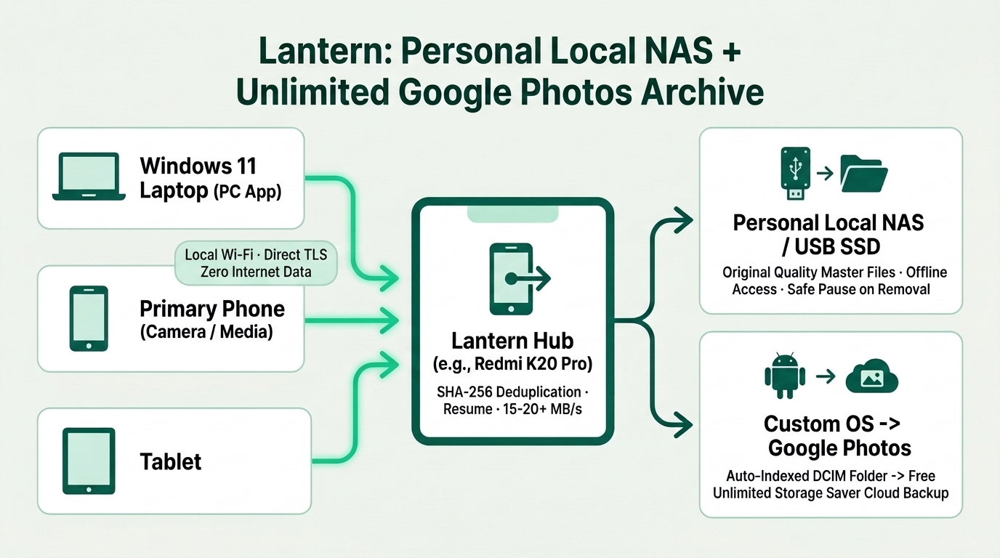
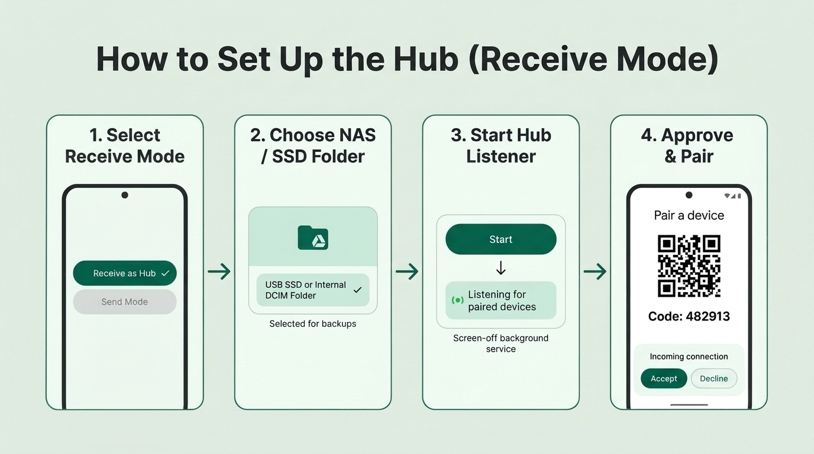
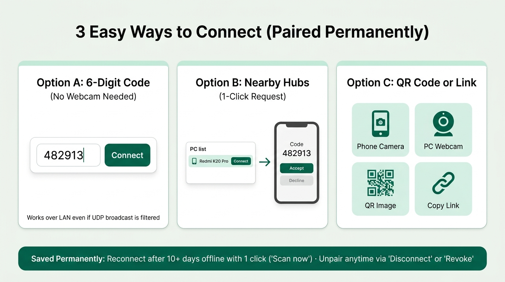
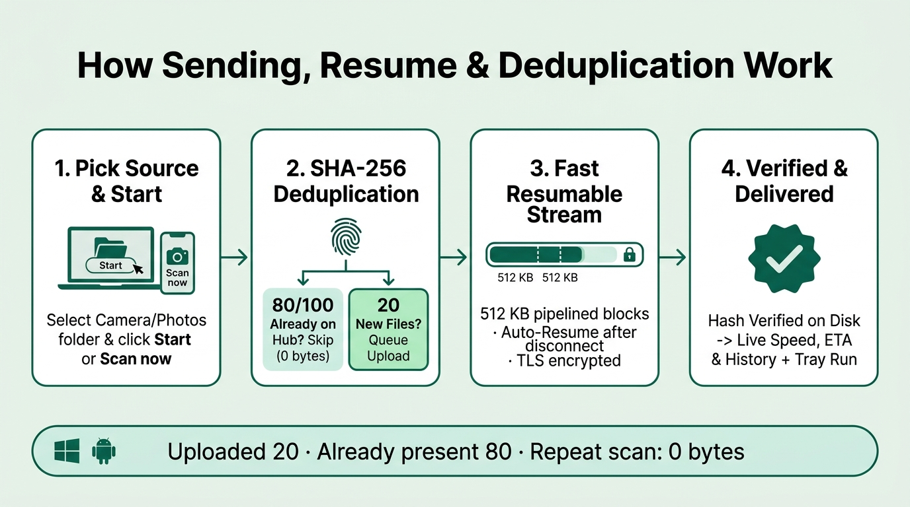

# Lantern — Personal Local NAS & Unlimited Google Photos Archive Sync

**Lantern** is a fast, privacy-first, zero-internet photo and video sync tool built in **Kotlin** for **Android** and **Windows 11**. Turn any spare Android phone (for example, a Redmi K20 Pro) with internal storage or a USB SSD into your own **Personal Local NAS** — and pair it with a Custom OS Google Photos build for **free unlimited cloud photo/video archiving** while keeping full-resolution original master copies safely at home.



---

## Why Lantern?

- **Zero Internet Data Used**: All transfers happen directly over your local Wi-Fi / LAN (`TLS 1.2 / 1.3`). Even if your router has no internet connection, LAN sync runs at full local Wi-Fi speed (**15–20+ MB/s** with pipelined 512 KB blocks).
- **IPv4 + Automatic IPv6 Link-Local Fallback**: If your Wi-Fi drops IPv4 peer-to-peer packets, Lantern automatically discovers and transfers over IPv6 link-local (`fe80::`), including across Wi-Fi reconnects and IP changes.
- **Bit-Exact SHA-256 Deduplication**: Compares file content by `SHA-256` hash rather than filename. Renamed copies or manually copied files already on the Hub upload **0 bytes**.
- **Chunked Auto-Resume & Crash Safety**: Interrupted large videos (for example, force-stop or Wi-Fi drop) resume from the exact Hub-confirmed byte offset. Finals are verified via `SHA-256` before renaming from `.lantern-*.part` to the final media file.
- **USB SSD & Storage Protection**: Tracks each destination's unique volume marker. If a USB SSD is unplugged or full, the Hub pauses safely and **never** silently writes files to internal storage.
- **Easy Permanent Pairing Without a Webcam**: Pair in seconds using a **6-digit code**, **Nearby Hubs (1-click Connect + Accept)**, **QR code**, **QR screenshot**, or **pairing link**. Stay disconnected for 10+ days, reopen, click **Scan now**, and reconnect automatically — or click **Disconnect** / **Revoke** anytime.

---

## How Unlimited Google Photos Archive + Personal NAS Works

Pairing Lantern with a dedicated Android Hub gives you a **3-2-1 hybrid backup** at zero monthly subscription cost:

1. **Daily Devices Stay Clean & Fast (Senders)**
   Your main phone (e.g., Xiaomi 12 Pro), tablet, and Windows 11 laptop run Lantern in **Send** mode. They automatically detect new photos/videos in your selected folders and stream them to your Hub whenever you are on home Wi-Fi.
2. **Your Android Hub Acts as a Personal NAS (`Receive as Hub`)**
   Keep your Hub device plugged in at home (for instance, a Redmi K20 Pro connected to power or a USB-C hub + external USB SSD):
   - **Local Master NAS Copy**: Point Lantern's Destination folder to an external **USB SSD** (or large internal storage) so you always hold 100% original, uncompressed photos/videos completely offline under your physical control.
   - **Auto-Indexed Cloud Archive (Custom OS)**: When running on an Android Custom ROM / Pixel-props build that includes unlimited Google Photos backup (such as Storage Saver or supported Pixel spoofing builds), set Lantern's Destination folder to an indexed internal `DCIM` subfolder (for example `Internal Storage/DCIM/LanternHub`) and enable backup for that folder inside **Google Photos → Backup → Back up device folders**.
3. **Automatic Cloud Sync Without Quota**
   Every photo and video sent from your PC, tablet, or main phone lands directly inside the Hub's watched `DCIM` folder, triggers Android media scanning, and gets archived automatically by Google Photos on the Custom OS — without filling up paid cloud storage on your primary devices.

> [!IMPORTANT]
> **Best Practices for Custom OS + Personal NAS:**
> - **Google Photos & External USB SSD**: Google Photos on Android generally monitors internal storage (`DCIM` / `Pictures`) and SD cards rather than temporary USB OTG drives. If your primary goal is **Google Photos unlimited archive**, save to an internal `DCIM/LanternHub` folder (and optionally mirror/copy periodically to a USB SSD or Windows drive). If your primary goal is a **high-capacity Personal Local NAS**, select your USB SSD directly as the Hub destination.
> - **Use a Dedicated Google Account & Keep Local Originals**: Custom ROM device-spoofing props depend on Google Photos server policies and can change over time. Always keep your local NAS / SSD master copy intact and avoid putting irreplaceable sole copies only in cloud storage.

---

## Step 1: Download & Install

Grab the latest builds from the **[GitHub Releases](../../releases)** page:

| Platform | File | How to Run |
|---|---|---|
| **Android** (Hub & Senders) | `Lantern-Android-debug.apk` | Install the APK on your Hub phone (e.g., Redmi K20 Pro) and any Android sender phones/tablets. |
| **Windows 11 x64** (Sender / Hub) | `Lantern-Windows-x64.zip` | Extract the ZIP anywhere and run `Lantern\Lantern.exe` (includes bundled JDK 21 runtime — no separate Java setup required). |

---

## Step 2: How to Set Up the Receiver (Hub Mode)



1. Open **Lantern** on the device that will store your photos/videos (e.g., Redmi K20 Pro).
2. Tap **Receive as Hub** at the top.
3. Tap **Choose folder** under **Destination folder** and grant permission to either:
   - An internal `DCIM` subfolder (recommended for automatic Google Photos Custom OS backup), **or**
   - An external **USB SSD** folder (recommended for high-capacity Personal NAS storage).
4. Tap **Start**. The status updates to `Listening for paired devices`, and Android keeps a persistent Foreground Service alive (`Lantern · Receiving Hub`) so transfers continue even when the screen turns off.
5. Tap **Pair a device** whenever you are ready to connect a new phone, tablet, or Windows PC. You will see:
   - A large **6-digit Pairing Code** (valid for 2 minutes, single-use, 5-attempt limit)
   - A **QR code**
   - **Copy pairing link** and **Share link** buttons
6. *(Android Battery Tip for Prolonged Screen-Off NAS Use)*: In MIUI / HyperOS / custom Android settings for Lantern, set **Battery saver** to **No restrictions** and enable **Autostart** so Android never kills the Hub listener overnight.

---

## Step 3: How to Connect Devices (3 Pairing Methods)

All pairing methods save an ECDSA-pinned TLS credential permanently on both devices. You only pair once.



### Option A — 6-Digit Pairing Code *(Easiest for Windows PC / No Webcam)*

1. On the **Hub** phone, tap **Pair a device** to display `Pairing code · XXXXXX` (valid for 2 minutes).
2. On your **Windows PC** or **Android sender** (**Send** mode), type those **6 digits** (or **`XXXXXX@192.168.0.121`** using the Hub's displayed Wi-Fi IP if discovery is blocked by router isolation) into the **`6-digit code, code@IP, or link`** box.
3. Click **Connect**. Lantern discovers the Hub on your LAN (broadcast + `/24` unicast + TCP probe fallback), verifies its TLS certificate, validates the 6-digit code, and saves the pairing permanently.

### Option B — Nearby Hubs (1-Click Request + Hub Approval)

1. In **Send** mode, Lantern automatically searches your Wi-Fi for active Hubs under **Nearby Hubs** (or click **Refresh**).
2. Click **Connect** next to your Hub's name (e.g., `Redmi K20 Pro`). A 6-digit verification code appears on the sender.
3. On the **Hub**, an **Incoming connection request** card (and notification) pops up showing the sender name, IP address, and matching 6-digit code. Tap **Accept** (or **Decline**).

### Option C — QR Code, Webcam, QR Screenshot, or Pairing Link

- **Phone Camera**: Tap **Scan QR** on an Android sender and point it at the Hub's QR code.
- **PC Webcam / QR Screenshot**: Click **Scan with webcam** or **Open QR image** on Windows (great if you take a screenshot of the QR code).
- **Direct Pairing Link**: Tap **Copy pairing link** / **Share link** on the Hub and paste the `Lantern/1|...` string into **`6-digit code or pairing link`** if your Wi-Fi blocks all discovery packets.

### Permanent Reconnect After Days Offline & Easy Disconnect

- **Auto-Reconnect After 10+ Days Away**: Closing Lantern or leaving Wi-Fi for days keeps your pairing saved. Reopen Lantern and click **Start** or **Scan now** — if the Hub's router IP changed, Lantern automatically re-discovers it over IPv4/IPv6 link-local and resumes syncing.
- **Unpair Anytime**: Click **Disconnect** on the sender (forgets the Hub cleanly), or click **Revoke** next to a device in the Hub's paired devices list.

---

## Step 4: How to Send & Monitor Progress



1. On your **Windows PC**, **Android phone**, or **tablet**, ensure **Send** mode is selected.
2. Click **Choose folder** under **Watched folder** and pick your camera, screenshots, or photo export directory (e.g., `DCIM/Camera` on Android or `Pictures` on Windows).
3. Click **Start** (or **Scan now** to trigger an immediate scan without waiting for the background interval):
   - **Smart Deduplication (100/80 Rule)**: If 80 out of 100 photos already exist on the Hub (even under different filenames or subfolders), Lantern uploads **only the missing 20 files**. Running a second scan uploads **0 bytes**.
   - **File-Writing Guard**: Files currently being recorded or written wait until stable across scans before hashing and uploading.
   - **Same-Size Replacement Detection**: Re-hashes locally when storage providers lack a reliable change token so modified files with identical byte sizes and timestamps are still delivered safely alongside earlier versions (`photo (1).jpg`).
   - **Live Telemetry & History**: View active filename, percentage, bytes transferred, live `MB/s` speed, ETA, queue count (`filesDone / filesTotal`), and recent **Transfer history** (`Clear` anytime).
4. **Windows System Tray**: Closing the Windows window with `X` minimizes Lantern silently to the **System Tray** so transfers continue in the background. Double-click the tray icon or choose **Open Lantern** to bring the window back without spawning duplicate transfer workers, or choose **Exit** from the tray menu to stop completely.

---

## Tech Stack & Security Architecture

| Layer | Technology |
|---|---|
| **Shared Core (`:core`)** | Pure Kotlin/JVM (`Engine.kt`, `Network.kt`, `Storage.kt`), Java `SSLSocket` / `SSLServerSocket` (`TLSv1.2` / `TLSv1.3`), OkHttp TLS (`HeldCertificate` ECDSA P-256 cert pinning), `SHA-256` verification, `512 KB` 8-chunk pipelining |
| **Android App (`:android`)** | Kotlin + Jetpack Compose (`Material 3`), Storage Access Framework (`SafTree.kt`), Foreground Service (`LinkService.kt`) with Wi-Fi High-Perf Lock & WakeLock, ZXing QR (`4.3.0`) |
| **Windows Desktop App (`:windows`)** | Kotlin/JVM 21 + Compose Desktop (`1.10.3`), Java AWT SystemTray & Swing file dialogs (`DiskTree.kt`), `webcam-capture` (`0.3.12`), ZXing JavaSE (`3.5.3`), `jpackage` native bundle |
| **Security Guarantees** | Self-signed ECDSA Hub cert pinned via 256-bit SHA-256 fingerprint (`pin`); per-sender 256-bit random auth tokens stored hashed (`peer.<sha256>`); strict path traversal sanitization inside selected Hub destination; single-writer lock (`acquirePartial`) per `(destination, sender, path)` |

---

## Building & Running Tests from Source

### Prerequisites
- **JDK 21** (full JDK including `jpackage` for Windows packaging)
- **Android SDK** (`compileSdk 36`, `minSdk 28`, `targetSdk 35`)

### Run All Automated Tests & Build Android APK

```powershell
$env:ANDROID_HOME = "$env:LOCALAPPDATA\Android\Sdk"
$env:JAVA_HOME = "C:\Program Files\Android\Android Studio\jbr"
.\gradlew.bat test :android:assembleDebug
```

Output APK: `android\build\outputs\apk\debug\android-debug.apk`

### Build Standalone Windows x64 Package

```powershell
.\Build-Windows.ps1 -Jdk "C:\path\to\jdk-21"
```

Output ZIP: `dist\Lantern-Windows-x64.zip` (extract and launch `Lantern\Lantern.exe`).

---

## License

MIT License — see [LICENSE](LICENSE).
